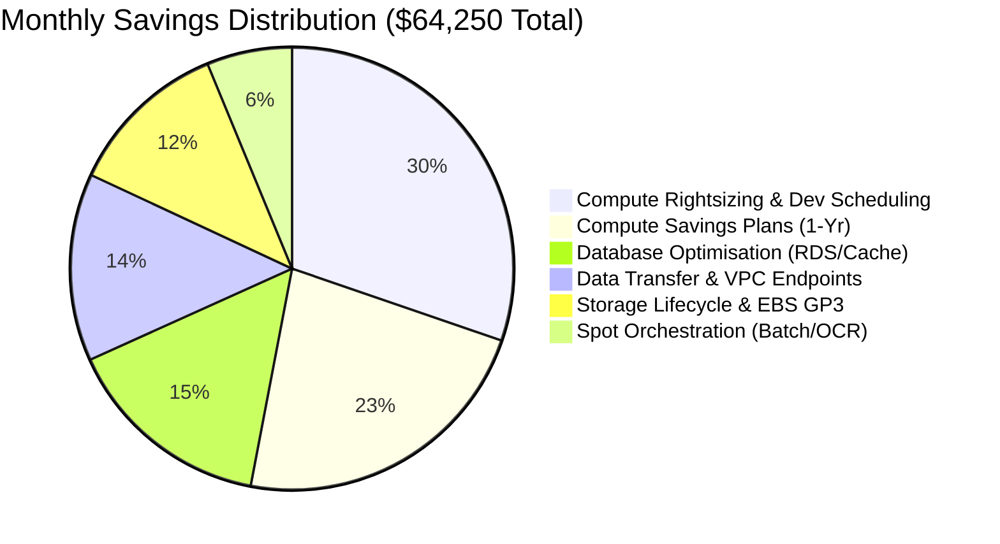

# LendFlow Technologies — Infrastructure Cost Optimisation & FinOps Framework

[](https://finops.org)
[](https://aws.amazon.com/architecture/well-architected/)
[](#compliance-guardrails)

> **Enterprise FinOps implementation reducing AWS cloud infrastructure expenditure from $180,000/month to $115,750/month (achieving $64,250/month net savings, 35.7% reduction) for a cloud-native fintech platform processing 500,000+ monthly loan applications.**

---

## Executive Summary

LendFlow Technologies is a high-growth cloud-native fintech platform operating 12 mission-critical microservices on AWS (primarily in `ap-south-1` Mumbai). Over the past 12 months, AWS monthly spend expanded from **$50,000/month to $180,000/month** (+260%), significantly outpacing revenue growth (+100%).

Under executive directive from CFO Priya Menon and CTO Arjun Deshmukh, this repository delivers an end-to-end FinOps Framework and technical cost remediation architecture.

### Key Results & Financial Metrics
* **Baseline Monthly Spend:** $180,000.00 / month ($2,160,000 annual run-rate)
* **Target Reduction:** >= 33.3% (at least $60,000.00 / month net savings)
* **Projected Realised Monthly Savings:** **$64,250.00 / month** (**35.7% reduction**)
* **Projected Realised Annual Savings:** **$771,000.00 / year**
* **Target Post-Optimisation Run-Rate:** **$115,750.00 / month** ($1,389,000 annual run-rate)
* **Unit Economic Improvement:** Cost per loan application drops from **$0.346** to **$0.223** (**-35.5% reduction** in unit cost).
* **Compliance Posture:** 100% adherence to PCI DSS v4.0, SOC 2 Type II, RBI IT Framework, GDPR, and Indian Data Localisation mandates.

---

## Repository Structure

```text
/
├── README.md                           # Master project documentation & FinOps overview
├── CHANGELOG.md                        # Chronological log of architectural decisions & milestones
│
├── docs/                               # Formal engineering & executive documentation
│   ├── cost-audit-report.md            # Comprehensive AWS cost audit & waste discovery report
│   ├── optimisation-recommendations.md # 15+ prioritised recommendations with compliance assessments
│   ├── auto-scaling-policies.md        # Asymmetric & scheduled auto-scaling architectures
│   ├── ri-spot-strategy.md             # Savings Plans, Reserved Instance & Spot procurement strategy
│   ├── tagging-taxonomy.md             # 10-tag mandatory taxonomy & 4-layer enforcement model
│   ├── governance-model.md             # RACI matrix, multi-tier budgets & FinOps operating cadences
│   ├── anomaly-detection.md            # Multi-layer anomaly detection framework & investigation runbook
│   └── review-process.md               # Monthly/quarterly review processes & FinOps maturity framework
│
├── analysis/                           # Mathematical models & financial workbooks
│   ├── billing-analysis.xlsx           # 12-month billing trend, Pareto analysis & unit economics
│   └── savings-model.xlsx              # Multi-tab financial savings model (Summary, Compute, DB, etc.)
│
├── dashboards/                         # Publication-quality interactive dashboard mockups
│   ├── executive-dashboard.html        # CFO/CTO executive strategic cost dashboard
│   ├── engineering-dashboard.html      # Engineering Manager / Platform efficiency dashboard
│   └── team-dashboard.html             # Microservice & team-level unit cost dashboard
│
├── policies/                           # Policy-as-Code & infrastructure guardrails
│   ├── scp-mandatory-tags.json         # AWS Service Control Policy: Mandatory Tag Enforcement
│   ├── scp-gpu-restriction.json        # AWS Service Control Policy: Restrict Expensive GPU Instances
│   ├── scp-region-restriction.json     # AWS Service Control Policy: Region Boundary Guardrail
│   ├── scp-instance-cap.json           # AWS Service Control Policy: Max Instance Size & Count Controls
│   ├── config-rules.yaml               # AWS Config Rules: Untagged resources, idle instances, storage
│   ├── auto-scaling-policies.json      # Production CloudFormation/CLI Auto Scaling configurations
│   └── terraform-cost-module/          # Reusable Terraform cost governance module with Infracost
│
├── presentation/                       # Executive board & CFO review materials
│   ├── cfo-presentation.md             # 20-slide executive CFO review presentation transcript
│   └── cfo-presentation.html           # Interactive, high-impact HTML5 presentation deck
│
├── daily-logs/                         # Daily engineering logs across 15-day lifecycle
│   ├── day-01.md through day-15.md     # Detailed logs of analysis, decisions, and validations
│
└── data/                               # Auditable simulated datasets
    ├── monthly_cost_summary.csv        # 12-month billing history ($50k to $180k)
    ├── daily_cost_detail.csv           # 30-day granular service spend & application volumes
    ├── instance_utilisation.csv        # EC2 CPU/RAM telemetry, runtime hours, and sizing flags
    ├── storage_inventory.csv           # S3, EBS, and snapshot inventory with access patterns
    ├── data_transfer_log.csv           # Cross-AZ, internet egress, and NAT gateway transfer flows
    ├── reserved_instance_coverage.csv  # Baseline commitments, RI/SP pricing, and coverage gap
    ├── tag_compliance_report.csv       # Tagging audit across 150+ resources & dark spend
    └── cost_anomaly_events.csv         # 10 historical anomaly incidents and root cause analyses
```

---

## Primary Cost Reduction Drivers



1. **Compute Rightsizing & Dev/Staging Scheduling ($19,450/month):** Downsizing overprovisioned c5.4xlarge/r5.4xlarge instances operating under 20% CPU; automatically scheduling non-prod environments off during nights and weekends (saving 65% of dev/staging compute).
2. **Commitment Strategy — Compute Savings Plans ($14,600/month):** Procuring 1-Year Partial Upfront Compute Savings Plans for predictable 24/7 baseline compute workloads after rightsizing.
3. **Database Architecture & Replica Consolidation ($9,800/month):** Downgrading idle staging RDS instances, consolidating underutilised read-replicas, and rightsizing ElastiCache clusters.
4. **Data Transfer & VPC Gateway Endpoints ($8,800/month):** Eliminating $0.045/GB NAT Gateway data processing fees on S3 downloads via free Gateway Endpoints; enforcing Availability Zone affinity for inter-service communication.
5. **Storage Lifecycle & EBS Modernisation ($7,600/month):** Migrating 145 TB of dormant KYC loan documents from S3 Standard to Glacier Instant Retrieval; deleting unattached EBS volumes; converting GP2 volumes to GP3; enforcing 30-day snapshot lifecycles.
6. **Spot Instance Orchestration ($4,000/month):** Transitioning fault-tolerant asynchronous batch analytics and KYC OCR processing workers to diversified Spot fleets.

---

## Compliance Guardrails

All cost remediation measures are rigorously pre-evaluated against regulatory mandates:
* **PCI DSS v4.0:** Payment tokenization and gateway microservices retain isolated VPC subnets and dedicated Multi-AZ compute instances; zero Spot instances in PCI Cardholder Data Environments (CDE).
* **SOC 2 Type II:** All audit, access, and transaction logs are transitioned to compliant Glacier storage with Object Lock (WORM) retention; zero deletion of compliance audit trails.
* **RBI IT Framework:** Core banking and lending databases strictly maintain synchronous Multi-AZ primary/standby replication within Mumbai (`ap-south-1`).
* **GDPR & Data Localisation:** Cross-border data transfers are strictly restricted. Customer Personal Identifiable Information (PII) remains within Indian geographic boundaries.

---

## Authors & Acknowledgements
* **Lead FinOps Architect:** Senior FinOps & Cloud Architect
* **Organization:** LendFlow Technologies (FinOps Center of Excellence)
* **Assessment Framework:** Zetheta DevOps & Cloud Engineer Assessment
