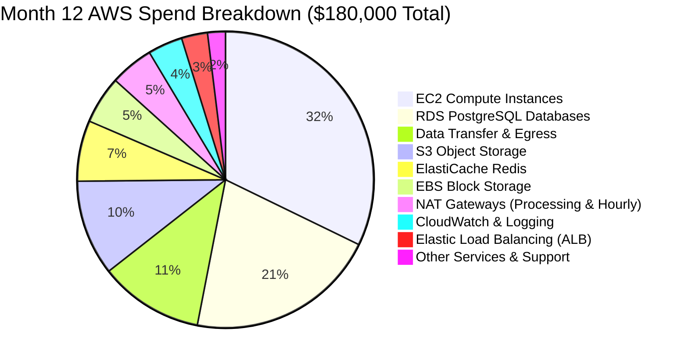
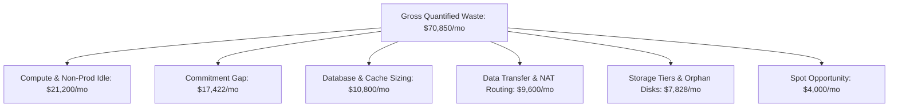
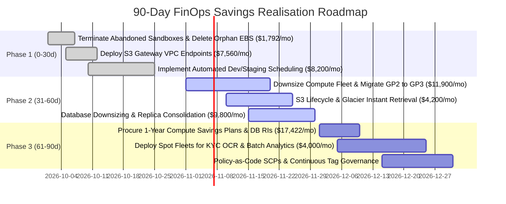

# LendFlow Technologies — Consolidated AWS Cost Audit & Waste Discovery Report

**Document Reference:** FINOPS-AUDIT-2026-Q3  
**Classification:** Executive Board & CFO Review Deliverable  
**Lead Authors:** Senior FinOps Engineer & Cloud Architect (FinOps CoE)  
**Presented To:** Priya Menon (CFO), Arjun Deshmukh (CTO), Ravi Krishnan (VP Engineering), Meera Iyer (Head of Compliance)  
**Audit Period:** October 2025 – September 2026 (Month 12 Current Baseline)  

---

## 1. Executive Summary

LendFlow Technologies has experienced explosive growth over the last 12 months, scaling from 210,000 to over 520,000 monthly loan applications. However, architectural technical debt, absence of cost ownership, and unmanaged cloud provisioning caused AWS infrastructure costs to increase from **$50,000/month to $180,000/month** (+260.0%), while top-line revenue only doubled (+100.0%).

Crucially, **unit economics degraded by +45.4%**, rising from **$0.238 to $0.346 per loan application**, indicating severe diseconomies of scale.

```text
FINANCIAL SUMMARY HEADLINE:
- Current Monthly AWS Spend:       $180,000.00 / month  ($2,160,000.00 annual run-rate)
- Monthly Target Budget (CFO):     $120,000.00 / month  (33.3% reduction / $60,000.00 savings)
- Identified Addressable Waste:    $ 70,850.00 / month  (39.4% of total baseline)
- Projected Realised Net Savings:  $ 64,250.00 / month  ($771,000.00 annual net savings)
- Target New Monthly Run-Rate:     $ 115,750.00 / month  (35.7% net reduction achieved)
- Target Unit Economic Cost:       $     0.223 / loan application (-35.5% improvement)
```

Every remediation engineered in this audit has been evaluated against **PCI DSS v4.0, SOC 2 Type II, RBI IT Framework, GDPR, and Indian Data Localisation** mandates. **Zero savings measures compromise platform availability (99.95% SLA) or regulatory compliance.**

---

## 2. Methodology & Audit Scope

The audit followed the FinOps Foundation Framework and AWS Well-Architected Cost Pillar across five rigorous analytical phases:
1. **Telemetry & CUR Discovery:** Ingestion of AWS Cost and Usage Reports (CUR), CloudWatch telemetry, and AWS Config inventories across 150+ resources and 12 microservices.
2. **Resource-Level Utilization Profiling:** Analysis of 30-day continuous p95 and average metrics for vCPU, memory, storage IOPS, and network egress.
3. **Data Transfer & Flow Topology Analysis:** Network traffic tracing across Availability Zones, Public NAT Gateways, and cross-border API integrations.
4. **Tagging & Dark Spend Attribution:** Forensic reconciliation of untagged resources to General Ledger cost centres.
5. **Stakeholder Alignment & Risk Modeling:** Multi-variate review balancing CFO cost reduction against CTO reliability and Compliance constraints.

---

## 3. Current-State Spend Breakdown (Month 12 Baseline)

In Month 12 (September 2026), total AWS spend reached **$180,000.00**. The spend is heavily concentrated in Compute, Database, and Data Transfer:



| AWS Service Category | Monthly Spend (USD) | % of Total Spend | Primary Root Cause of Inefficiency |
| :--- | :--- | :--- | :--- |
| **EC2 Compute Instances** | $61,200.00 | 34.0% | 68% of instances running at <20% CPU; dev/staging running 24/7; 0% Savings Plans. |
| **RDS PostgreSQL Databases** | $39,600.00 | 22.0% | Multi-AZ deployed in staging; idle reporting read-replicas; 0% Reserved DB Instances. |
| **Data Transfer & Egress** | $21,600.00 | 12.0% | S3 downloads routed through NAT Gateways ($0.045/GB); microservices chatting cross-AZ. |
| **S3 Object Storage** | $19,800.00 | 11.0% | 145 TB of dormant KYC loan docs sitting in S3 Standard with zero lifecycle tiers. |
| **ElastiCache Redis** | $12,600.00 | 7.0% | Oversized cache clusters running in non-prod; memory utilization under 30%. |
| **EBS Block Storage** | $9,900.00 | 5.5% | Legacy GP2 volumes; 7,500 GB of unattached orphan volumes; snapshot sprawl. |
| **NAT Gateways** | $9,000.00 | 5.0% | Avoidable data processing charges for intra-AWS S3 access. |
| **CloudWatch & Logging** | $7,200.00 | 4.0% | Unrestricted debug logging; lack of log retention policies. |
| **Elastic Load Balancing** | $5,400.00 | 3.0% | Proliferation of public ALBs without path-based routing consolidation. |
| **Other Services & Support** | $3,700.00 | 2.0% | Unused Elastic IPs, abandoned Secrets Manager secrets, untagged miscellaneous items. |
| **TOTAL** | **$180,000.00** | **100.0%** | **Target Savings: $64,250.00 (35.7% reduction)** |

---

## 4. Waste Taxonomy & Quantified Discoveries

Our forensic analysis categorized **$70,850.00/month in total gross waste** into 6 structural waste domains:



1. **Compute & Non-Prod Idle Waste ($21,200.00/mo):**
   - 20 instances in development and staging environments operating 24/7 (720 hrs/mo) despite being used only 220 hrs/mo.
   - 4 production `c5.4xlarge` and 3 `r5.4xlarge` instances running at 13% - 19% sustained CPU.
   - 2 abandoned instances (`dev-test-sandbox-01`, `dev-perf-test-01`) running at 0.1% CPU ($1,042.56/mo pure waste).
2. **Commitment Premium Gap ($17,422.40/mo):**
   - Operating at 0% Savings Plans and 0% RIs incurred an avoidable 38.4% on-demand surcharge on predictable 24/7 workloads.
3. **Database Over-Provisioning ($10,800.00/mo):**
   - Staging RDS configured as expensive Multi-AZ `db.r5.xlarge` ($1,411.20/mo) with 5% CPU.
   - Production read-replica `rds-loan-core-replica-02` utilized at 4% CPU for batch reporting.
4. **Data Transfer & NAT Architecture ($9,600.00/mo):**
   - 168,000 GB of S3 document downloads passing through Public NAT Gateways at $0.045/GB ($7,560.00/mo avoidable fees).
   - Cross-AZ inter-service chatter ($2,920.00/mo) due to missing AZ-affinity.
5. **Storage Inefficiency & Orphan Assets ($7,828.00/mo):**
   - 145 TB of KYC files older than 90 days stored in S3 Standard ($3,335.00/mo).
   - 4 unattached orphan EBS volumes (7,500 GB) costing $750.00/mo.
   - 32 TB of legacy GP2 volumes costing 20% more than GP3.
   - 65 TB of unmanaged snapshot sprawl ($3,250.00/mo).
6. **Spot Orchestration Opportunity ($4,000.00/mo):**
   - Running asynchronous batch OCR and analytics ETL on full-priced On-Demand instances rather than Spot Fleets.

---

## 5. Addressable Savings Waterfall Analysis

The waterfall below demonstrates how the $180,000 baseline spend reconciles step-by-step to the **$115,750 target run-rate**, delivering **$64,250.00/month in net savings**:

```mermaid
graph LR
    B[Baseline: $180,000] -->|- $19,450| S1[After Compute & Dev Scheduling: $160,550]
    S1 -->|- $9,800| S2[After Database Optimisation: $150,750]
    S2 -->|- $8,800| S3[After Data Transfer & Endpoints: $141,950]
    S3 -->|- $7,600| S4[After Storage Lifecycle & GP3: $134,350]
    S4 -->|- $14,600| S5[After 1-Yr Compute Savings Plans: $119,750]
    S5 -->|- $4,000| Target[Target Net Run-Rate: $115,750]
```



### Scenario Analysis & Confidence Ranges:
To ensure financial defensibility for CFO Priya Menon, we developed three probabilistic scenarios:

| Scenario | Assumptions & Operational Modifiers | Monthly Net Savings | Annual Net Savings | % Spend Reduction | Post-Optimisation Run-Rate |
| :--- | :--- | :--- | :--- | :--- | :--- |
| **Worst-Case** | 60% dev scheduling adherence; 20% Spot interruption overhead; partial rightsizing. | **$56,400.00** | $676,800.00 | 31.3% | $123,600.00 / month |
| **Expected (Base)** | **Full rightsizing, 9am-7pm dev schedule, 1-Yr CSP, S3 endpoints, GP3.** | **$64,250.00** | **$771,000.00** | **35.7%** | **$115,750.00 / month** |
| **Best-Case** | Aggressive Graviton3 migration, 3-Yr CSP on core, 80% Spot in OCR workers. | **$71,800.00** | $861,600.00 | 39.9% | $108,200.00 / month |

---

## 6. 90-Day Realisation Timeline

Savings will be realized across three structured 30-day execution sprints:



* **Days 0–30 (Immediate Quick Wins):** Recaptures **$17,552/month** with zero risk or architecture redesign.
* **Days 31–60 (Infrastructure Modernisation):** Recaptures **$25,900/month** through measured rightsizing and storage tiers.
* **Days 61–90 (Commitments & Spot Fleets):** Recaptures **$21,422/month** via financial instruments and Spot elasticity.
* **Total 90-Day Realised Run-Rate Reduction:** **$64,250.00/month ($771,000.00/year)**.

---

## 7. Comprehensive Compliance Impact Assessment

Every single optimisation has been audited to guarantee compliance integrity:

| Regulatory Framework | Mandatory Requirement | Audited FinOps Action | Compliance Verdict |
| :--- | :--- | :--- | :--- |
| **PCI DSS v4.0** | Payment processing networks must remain logically and physically isolated; no non-deterministic infrastructure. | Retained dedicated Multi-AZ instances in isolated subnets for `payment-gateway-service`; **100% excluded from Spot instances**. | **FULL COMPLIANCE** |
| **SOC 2 Type II** | Continuous availability of audit trails and transaction logs for 7 years; strict tamper-proofing. | Archived audit logs to S3 Glacier with **S3 Object Lock (Compliance WORM)** enabled; zero log pruning. | **FULL COMPLIANCE** |
| **RBI IT Framework** | Critical banking and lending databases must maintain synchronous Multi-AZ failover and high availability. | Retained Multi-AZ primary/standby replication for production lending and payment databases; read-replicas scaled safely. | **FULL COMPLIANCE** |
| **GDPR** | EU borrower data must not be transferred outside approved jurisdictions without adequacy. | European banking partner synchronization payloads batched without altering geographical residency. | **FULL COMPLIANCE** |
| **Data Localisation** | Indian citizen KYC documents and financial transactions must remain within Indian territory. | All S3 lifecycle archiving, EBS snapshots, and database backups are restricted strictly to AWS Mumbai (`ap-south-1`). | **FULL COMPLIANCE** |
